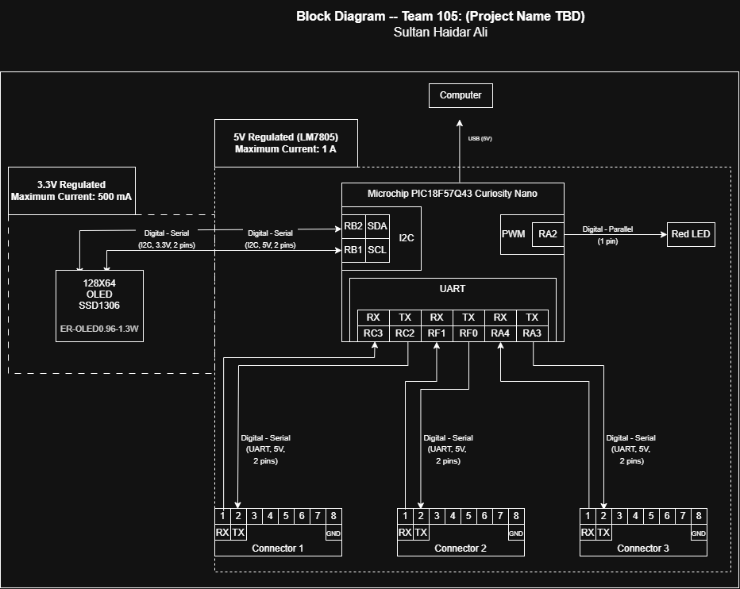

## Overview

This block diagram is the hub subsystem of RadioLink, Team 105's hub-and-spoke design. A Microchip PIC18F57Q43 Curiosity Nano sits at the center. A computer supplies 5 V over USB. An LM7805 provides the regulated 5 V rail from the 9 V input. A Microchip MCP1700-3302E/TO makes 3.3 V from that 5 V rail for the display. The MCP1700 is rated for 250 mA. The drawing below still prints 500 mA on the 3.3 V rail, which was the placeholder before this part was selected.

The microcontroller drives an EastRising ER-OLED0.96-1.3W over I2C. That module is a 128 x 64 panel with an SSD1306 controller. It is not a UG-2864HSWEG01. SDA is RB2 and SCL is RB1, after the 2N7000 level shifters. The OLED side of that bus is 3.3 V, and the microcontroller side is 5 V. A red LED is driven from RA2 using PWM. The module is the intentional exception to the through-hole preference.

Three UART ports connect this hub to the other boards. Each link is 5 V and uses an RX/TX pair:

- Connector 1: RX on RC3, TX on RC2
- Connector 2: RX on RF1, TX on RF0
- Connector 3: RX on RA4, TX on RA3

These ports connect to the microphone board, the button and temperature board, and the speaker board. The microphone and button boards send data in. The hub shows temperature readings and the audio path on the OLED, and it sends the microphone signal out to the speaker.

## Block Diagram

**Figure 1:** Hub block diagram for RadioLink. The drawing still labels the 3.3 V regulator as 500 mA. The selected 3.3 V part is the MCP1700-3302E/TO, rated 250 mA.

## Resources

The exported block diagram is available as a [*ZIP archive*](Hub-Block-Diagram-Source.zip).
