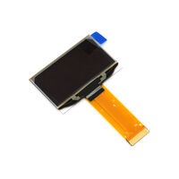
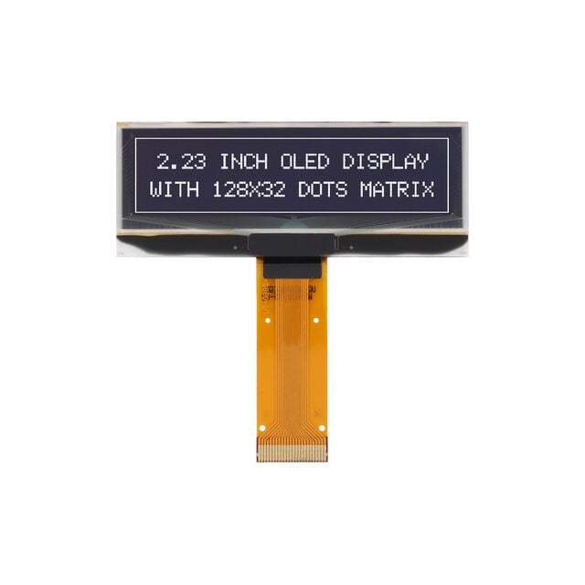
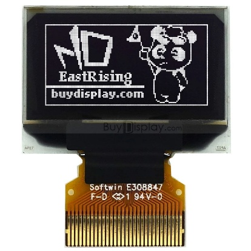
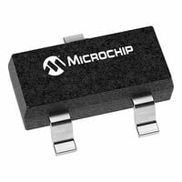
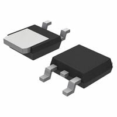

The hub PCB is meant to be assembled, soldered, inspected, and repaired by hand. Through-hole packages are preferred wherever they are practical. The OLED module is an intentional exception, because that display assembly is not a discrete through-hole part.

Four parts were selected against that rule: the display module, the 9 V to 5 V regulator, the I2C level-shift MOSFETs, and the 5 V to 3.3 V regulator. SSD1306 is the controller inside the display. It is not the orderable module.

## OLED Display

**Requirements:** A readable graphic display for the hub UI, small enough for this board, with an I2C interface the PIC18F57Q43 can drive. Logic supply must work from the 3.3 V rail. The module may be a flex-connected assembly. It does not have to be through-hole.

SSD1306 names the controller IC. The orderable part is the EastRising module that uses that controller.

### Option 1: DLC-D1.54AGW#1

- $18.69 each
- [Link to product](https://www.digikey.com/en/products/detail/dlc-display-co-ltd/DLC-D1-54AGW-1/29925594)

| Pros | Cons |
| --- | --- |
| 128 x 64 resolution | 16-week lead time |
| Large 1.54-inch display | Requires 1 KB framebuffer |
| Common SSD1309 controller | Panel assembly, not a through-hole part |
| Open-source drivers available | Different controller from the selected module |

### Option 2: DLC-D2.23AGW#1

- $25.40 each
- [Link to product](https://www.digikey.com/en/products/detail/dlc-display-co-ltd/DLC-D2-23AGW-1/26822637)

| Pros | Cons |
| --- | --- |
| Large 2.23-inch display | Fewer SSD1305 libraries available |
| Easy to read | Requires 12.5 V VCC |
| Only 512 bytes of PIC RAM for framebuffer | More expensive |
| | Only 128 x 32 resolution |
| | Panel assembly, not a through-hole part |

### Option 3: ER-OLED0.96-1.3W

- $2.49 each
- [Link to product](https://www.buydisplay.com/128x64-oled-i2c-0-96-display-white-color-connector-fpc-ssd1306)
- [Series datasheet](https://www.buydisplay.com/download/manual/ER-OLED0.96-1_Series_Datasheet.pdf)

This is an EastRising 0.96-inch, 128 x 64, white OLED module with a top-contact FPC. The controller on the module is an SSD1306. The module is not a breakout board and it is not the UG-2864HSWEG01 drawn on the current schematic. That is a different orderable display that also uses an SSD1306.

EastRising lists VDD as 1.65 V to 3.3 V, typical 2.8 V. Logic-high is 0.8 x VDD. With the internal charge pump enabled, VBAT is specified as 3.5 V to 4.2 V. IDD is 180 µA typical and 300 µA maximum. With the charge pump generating VCC, IBAT at 100% of the pixels on is 25.6 mA typical and 32.0 mA maximum (datasheet Note 8: VDD = 2.8 V, generated VCC = 7.25 V). The framebuffer is 128 x 64 bits, which is 1 KB.

| Pros | Cons |
| --- | --- |
| SSD1306 controller, with I2C available on this module | 0.96-inch screen is small |
| 128 x 64 | FPC assembly, not through-hole |
| $2.49, and it was available to order | 1 KB framebuffer |
| Logic supply accepts 3.3 V | Charge-pump VBAT minimum in the datasheet is 3.5 V. **Verify** operation from the 3.3 V rail. |

**Choice:** ER-OLED0.96-1.3W

**Rationale:** The hub UI only has to show temperature and audio status. A 128 x 64 SSD1306 module does that, costs $2.49, and does not have the 12- and 16-week lead times of the larger panels. Option 2 also needs 12.5 V, which this board does not have. The FPC module is the intentional exception to the through-hole preference.

The current schematic symbol is still labeled UG-2864HSWEG01. That label is not this module. The KiCad symbol still has to be changed. See the schematic page.

## 9 V to 5 V Regulator

**Requirements:** Make a regulated 5 V rail from the 9 V barrel jack for the Curiosity Nano, the debug LED, and the current that the 3.3 V regulator draws. The package should be through-hole. The part must stay in regulation at 9 V and at the budgeted load, and the heat has to be acceptable without treating the regulator as an efficient converter.

The generic name "7805" is the 5 V family. The orderable part selected here is the STMicroelectronics L7805CV, which is the TO-220 single-gauge version of the L7805C.

### Option 1: L7805CV (STMicroelectronics)

- ~$1.08 each
- [Link to product](https://www.digikey.com/en/products/detail/stmicroelectronics/L7805CV/585964)
- [ST L78 datasheet](https://www.st.com/resource/en/datasheet/l78.pdf)

| Pros | Cons |
| --- | --- |
| Fixed 5 V, TO-220, through-hole | Linear regulator: the drop from 9 V to 5 V becomes heat |
| Output current up to 1.5 A | Quiescent current up to 8 mA at 25 °C |
| 9 V is inside the 7 V to 18 V test range used for the 5 V specification up to 1 A | Minimum load for regulation is 5 mA |
| Datasheet test circuit uses 0.33 µF in and 0.1 µF out, which is what the schematic already has (C9, C10) | Dropout is typically 2 V at 1 A and 25 °C, so it is not a low-dropout part |

### Option 2: MCP1702T-5002E/CB (Microchip)

- ~$0.65 each
- [Link to product](https://www.digikey.com/en/products/detail/microchip-technology/MCP1702T-5002E-CB/1098473)

| Pros | Cons |
| --- | --- |
| Very low quiescent current | 250 mA maximum output |
| Good for battery operation | SOT-23, not through-hole |
| Accepts up to 13.2 V input | Less common than the 7805 family |
| High DigiKey stock | |

This option is a 5.0 V LDO. It is not the 3.3 V regulator selected later.

### Option 3: MC7805CDTRKG (onsemi)

- ~$0.49 each
- [Link to product](https://www.digikey.com/en/products/detail/onsemi/MC7805CDTRKG/921037)

| Pros | Cons |
| --- | --- |
| Same 7805 family, 5 V output | Linear, so it also dissipates (9 V − 5 V) × Iout |
| Low cost | DPAK, not through-hole |
| Up to 1 A output | Harder to hand solder than TO-220 |

**Choice:** L7805CV

**Rationale:** The budgeted 5 V current, after the 25% margin, is 71.625 mA. That is far under 1.5 A, and it is above the 5 mA minimum load. At 9 V in, the headroom above 5 V is 4 V, which is more than the typical 2 V dropout at 1 A.

Dissipation at that margined output current, plus the 8 mA maximum quiescent current, is:

P = (9 V − 5 V) × 0.071625 A + 9 V × 0.008 A = 0.359 W

TO-220 junction-to-ambient thermal resistance in the ST datasheet is 50 °C/W, so the rise is about 18 °C. A heatsink is not required at this load. The efficiency is about 50% at this current, because a linear regulator turns the extra input voltage into heat. Simplicity is not the same thing as efficiency. The TO-220 package is why this part won over the smaller 7805 and the MCP1702.

## I2C Level-Shift MOSFET

**Requirements:** SDA and SCL have to cross between the 5 V PIC pins and the 3.3 V OLED pins. The translator has to be bidirectional, because I2C is open-drain. Two channels are required, one for SDA and one for SCL. The MOSFET should be N-channel, enhancement-mode, and through-hole. I2C current is set by the 10 kΩ pull-ups already on the schematic, so the channel current is well under 1 mA.

The circuit is the MOSFET level shifter used on the Adafruit monochrome OLED breakout: gate tied to the low-voltage rail, source on the low-voltage bus, drain on the high-voltage bus. The low side is 3.3 V. The high side is 5 V.

### Option 1: BSS138, as drawn on the current schematic

| Pros | Cons |
| --- | --- |
| N-channel MOSFET already used in this topology | SOT-23, not through-hole |
| Two devices are already placed as Q1 and Q2 | Not pin-compatible with a TO-92 2N7000 |
| | Exact gate threshold depends on which BSS138 manufacturer is fitted. That manufacturer was not recorded. |

### Option 2: onsemi 2N7000G

- TO-92, Pb-free 2N7000
- [onsemi 2N7000 datasheet](https://media.digikey.com/pdf/Data%20Sheets/ON%20Semiconductor%20PDFs/2N7000%20Rev7.pdf)

| Pros | Cons |
| --- | --- |
| N-channel enhancement MOSFET in TO-92 | VGS(th) is 0.8 V minimum and 3.0 V maximum at VDS = VGS and ID = 1 mA |
| VDSS 60 V, continuous ID 200 mA | RDS(on) is specified at VGS = 4.5 V and 10 V, not at 3.3 V |
| Body diode and gate connection match the level-shifter topology | A worst-case 3.0 V threshold on a 3.3 V gate has to be checked on the bench |
| Two parts cover SDA and SCL | Pinout is not the BSS138 pinout |

onsemi Style 22 numbers the TO-92 pins as pin 1 source, pin 2 gate, pin 3 drain. The PCB symbol, footprint, and routing have to follow that datasheet. Do not reuse the BSS138 footprint.

### Option 3: 2N7002

| Pros | Cons |
| --- | --- |
| Same 2N7000 electrical family, so the level-shifter discussion still applies | SOT-23, which loses the reason for leaving the BSS138 |
| | Still not a drop-in for the current BSS138 footprint without a footprint check |

**Choice:** two onsemi 2N7000G, Q1 and Q2

**Rationale:** Each I2C line needs its own MOSFET. The 2N7000G is selected because it is an N-channel enhancement MOSFET in TO-92 and the I2C current is tiny next to its 200 mA rating. In the shifter, the source connects to the 3.3 V side, the drain connects to the 5 V side, and the gate connects to 3.3 V.

It is electrically plausible for this current, and it is not guaranteed by the datasheet at the worst-case threshold. VGS(th) can be as high as 3.0 V, and the gate supply is 3.3 V. **Verify** that a worst-case part still pulls the 5 V side down through the 10 kΩ pull-ups. BSS138 and 2N7000G are not drop-in replacements.

## 5 V to 3.3 V Regulator

**Requirements:** A second regulator, separate from the L7805CV, has to make 3.3 V from the 5 V rail for the OLED. It needs a fixed 3.3 V output, a through-hole package, and enough current for the display. The load used here is the EastRising maximum of 32.0 mA IBAT plus 0.3 mA IDD, which is 32.3 mA, with the charge-pump caveat in the power budget.

This is not the 9 V to 5 V regulator.

### Option 1: Unlabeled 5-pin regulator on the current schematic

The schematic draws U2 as a 5-pin device with IN, EN, GND, OUT, and a pad pin. No manufacturer part number is on the sheet. The block diagram called this rail 500 mA. That rating was not tied to an orderable part.

| Pros | Cons |
| --- | --- |
| Already drawn | SOT-23-style package, not through-hole |
| Has an enable pin | MPN is unknown, so current, dropout, and capacitors cannot be checked |
| | 500 mA on the block diagram is not a datasheet rating |

### Option 2: Microchip MCP1700-3302E/TO

- Fixed 3.3 V, TO-92
- [Microchip MCP1700 datasheet](https://ww1.microchip.com/downloads/en/DeviceDoc/MCP1700-Data-Sheet-20001826F.pdf)

| Pros | Cons |
| --- | --- |
| Through-hole TO-92 | No enable pin, so the current 5-pin symbol cannot be reused |
| 250 mA maximum for a 3.3 V output | Input is only specified up to 6.0 V, so it must run from 5 V, not from 9 V |
| Input range 2.3 V to 6.0 V | |
| Typical quiescent current 1.6 µA, maximum 4 µA | |
| Stable with a 1.0 µF output capacitor, ESR 0 Ω to 2.0 Ω | |

TO-92 pin numbers in the Microchip pin table are pin 1 GND, pin 2 VIN, pin 3 VOUT. Dropout at 250 mA is 178 mV typical and 350 mV maximum for VR above 2.5 V. The 5 V input is 1.7 V above 3.3 V, which is above that dropout.

Junction-to-ambient thermal resistance for the TO-92 package in the datasheet is 92 °C/W. At 32.3 mA the dissipation is (5.0 V − 3.3 V) × 0.0323 A = 0.0549 W, about a 5 °C rise.

### Option 3: Microchip MCP1700T-3302E/TT

| Pros | Cons |
| --- | --- |
| Same MCP1700 electrical limits, including 3.3 V and 250 mA | SOT-23, not through-hole |
| Same capacitor requirements | Different pin order from the TO-92 part |

**Choice:** MCP1700-3302E/TO

**Rationale:** 32.3 mA is a small fraction of 250 mA, and the TO-92 package matches the hand-assembly goal. The SOT-23 version of the same regulator was rejected for the package. The unlabeled 5-pin part was rejected because it has no orderable number and it is not through-hole.

The schematic already has 10 µF capacitors at C1 and C2 around this regulator. Microchip requires at least 1.0 µF on the output, with ESR from 0 Ω to 2.0 Ω, and about 1 µF on the input for loads up to 100 mA. Larger input capacitance is allowed. A 10 µF capacitor meets the minimum. It is acceptable only if its ESR is inside 0 Ω to 2.0 Ω. The schematic does not state the dielectric. **Verify** that C1 and C2 are low-ESR parts, such as ceramic, before treating 10 µF as a finished MCP1700 design. The capacitance value does not have to change.

## MCC Configuration

The hub uses the PIC18F57Q43 on the Curiosity Nano. The clock is the internal HFINTOSC. There is no external crystal on the schematic. Peripheral pin select maps the digital pins below.

| Function | Peripheral | Pins |
| --- | --- | --- |
| System clock | HFINTOSC | Internal |
| OLED I2C, after the 2N7000G shifters | I2C | SDA on RB2, SCL on RB1 |
| Debug LED | PWM | RA2 |
| UART connector 1 | UART | TX on RC2, RX on RC3 |
| UART connector 2 | UART | TX on RF0, RX on RF1 |
| UART connector 3 | UART | TX on RA3, RX on RA4 |
| Debug button | GPIO input | SW1. The schematic does not label which PIC pin it uses. |

The three UART ports are the links to the microphone board, the button and temperature board, and the speaker board. The block diagram does not assign a connector number to a specific board, so this table does not either. I2C is shifted from 5 V at the microcontroller to 3.3 V at the OLED by Q1 and Q2. SW1 is the debug button on this board, not the user buttons on board 2.
