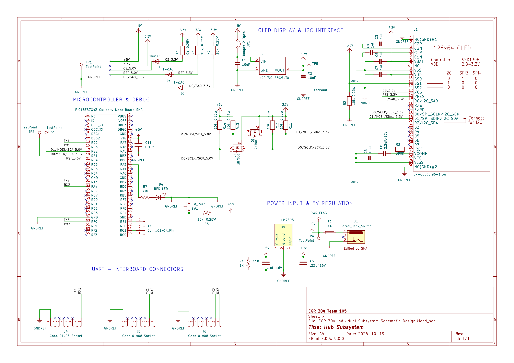

## Overview

The Hub subsystem is centered around a PIC18F57Q43 Curiosity Nano development board. It interfaces with a 128x64 SSD1306 OLED over I2C and provides UART connections for communication with the other team subsystems.

The design includes 9-12 V input power regulation to 5 V, a local 3.3 V supply for the OLED, I2C level shifting, a debugging LED and pushbutton, test points, an OLED power-isolation jumper, and fused 5 V power distribution to the connected boards.

**Figure 1:** Hub subsystem schematic showing the microcontroller and debugging circuitry, OLED display and I2C interface, power input and 5 V regulation, and UART inter-board connector.

## Resources

A high-resolution PDF of the schematic is available [*here*](Hub-Subsystem-Schematic.pdf).

The complete KiCad project, including the schematic, project files, custom/imported symbol libraries, footprint libraries, and reference files, is available as a [*ZIP archive*](Hub-Subsystem-KiCad-Project.zip).
