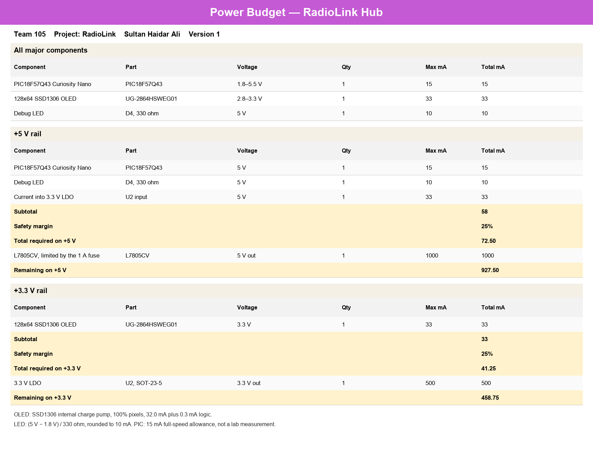
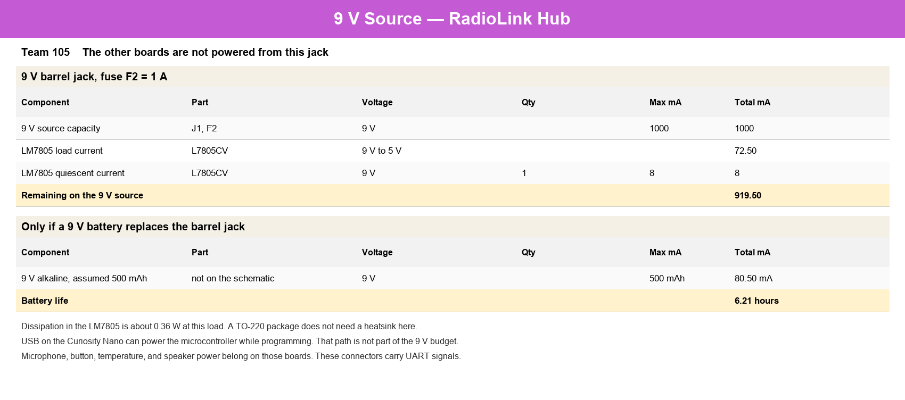

## Overview

This budget is for the RadioLink hub only. It covers the PIC18F57Q43 Curiosity Nano, the on-board OLED, the debug LED, and the regulators that feed them. The microphone, button, and speaker boards are not included. Their UART links are logic-level signals, and those boards carry their own supplies.

Currents are datasheet or circuit limits, not lab measurements. The template's 25% margin is kept on each rail. The spreadsheet is linked below.

## Rails

**Figure 1:** Major loads, the 5 V rail, and the 3.3 V rail.

**Figure 2:** Current drawn from the 9 V barrel jack, and the life of a 9 V battery if one is used in place of a wall supply.

## Conclusions

After the 25% margin, the hub asks the 5 V rail for 72.5 mA. The 1 A fuse and the LM7805 can both supply that, with 927.5 mA still unused. The OLED is the largest load, at 33 mA on the 3.3 V rail. The 3.3 V regulator is rated for 500 mA on the block diagram, so the display does not stress it.

The LM7805 drops 9 V to 5 V. At this load its dissipation is about 0.36 W, which a TO-220 package can handle without a heatsink. The 9 V input, limited by the 1 A fuse, still has 919.5 mA of spare current. That spare current is not a reason to power the speaker from this board. The speaker amplifier belongs on board 3.

A 500 mAh 9 V alkaline battery would run this hub for 6.21 hours. The schematic uses a barrel jack, so that figure only applies if a battery is substituted for the jack. USB on the Curiosity Nano can power the microcontroller during programming, and that path is separate from this 9 V budget.

## Resources

The spreadsheet is available as a [*ZIP archive*](RadioLink-Hub-Power-Budget.zip) and as an [*Excel file*](RadioLink-Hub-Power-Budget.xlsx).
