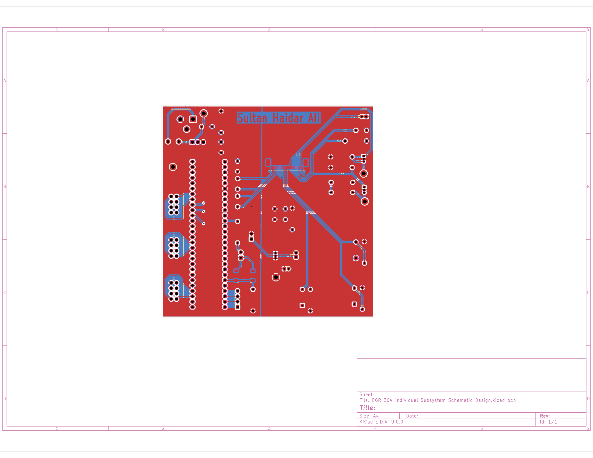
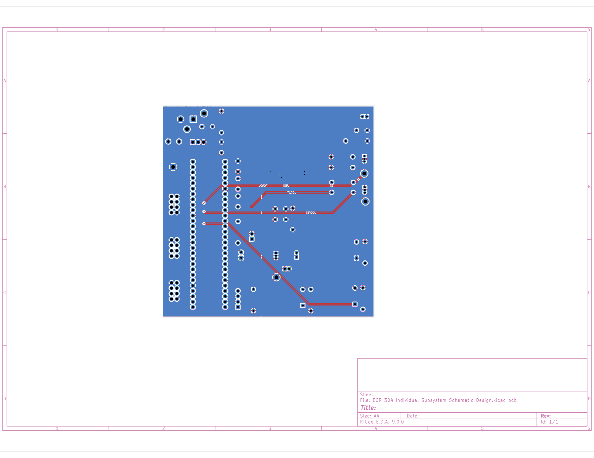

## Overview

This page is the printed circuit board for the RadioLink hub, Team 105. The layout follows the hub schematic: 9 V in, 5 V and 3.3 V regulation, the PIC18F57Q43 Curiosity Nano, the ER-OLED0.96-1.3W on an ER-CON30HT-1 ZIF, three UART connectors to the other boards, and the debug LED and button. The name **Sultan Haidar Ali** is on the front copper.

Front copper is red. Back copper is blue. Both images are the exported top and bottom layers of the current KiCad layout.

**Figure 1:** Front (top) copper of the hub PCB.

**Figure 2:** Back (bottom) copper of the hub PCB.

## Resources

High-resolution PDFs of the same layers:

- [Front copper PDF](PCB-Front.pdf)
- [Back copper PDF](PCB-Back.pdf)

The full KiCad project, including custom symbols, libraries, and footprints, is available as a [*ZIP archive*](RadioLink-Hub-KiCad-Project.zip).

Gerber and drill files for manufacturing are available as a [*separate ZIP archive*](RadioLink-Hub-Gerbers.zip).
